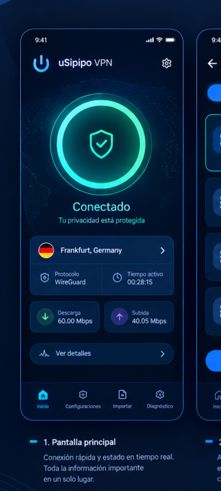
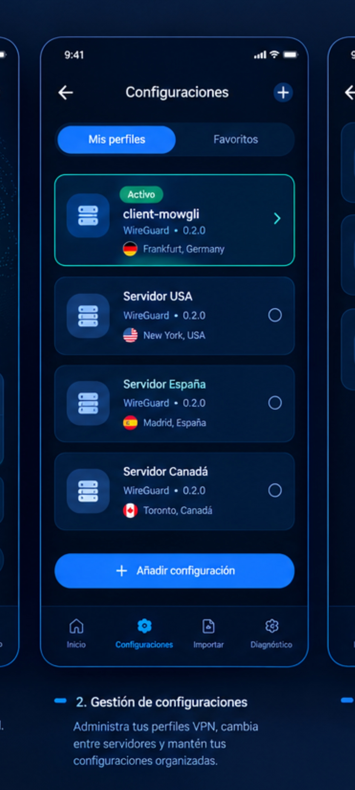
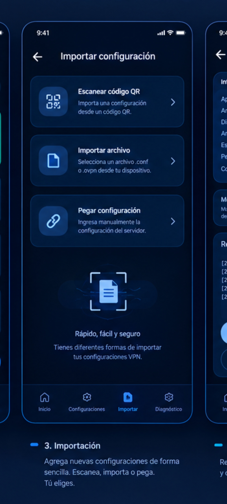
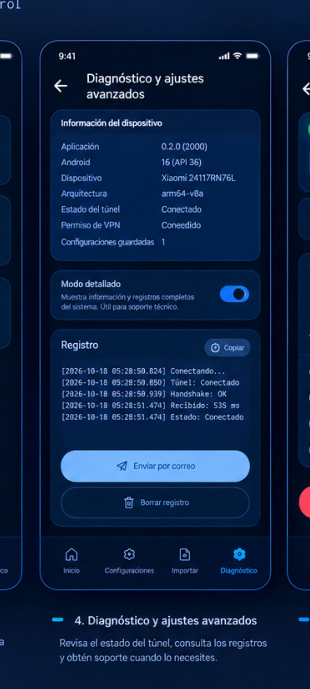
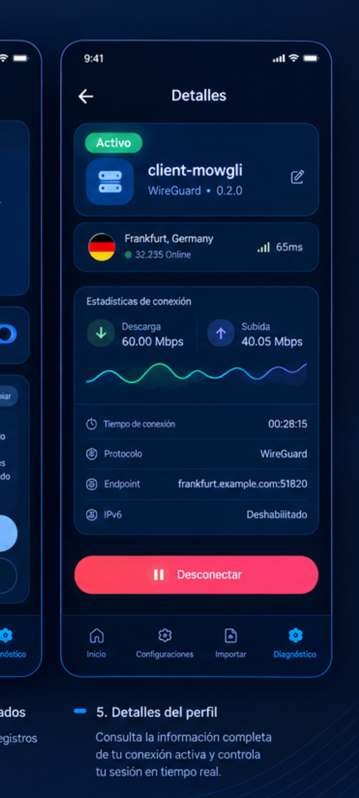

<div align="center">
  

  <h1>uSipipo VPN</h1>

  <p><strong>Cliente Android nativo para túneles WireGuard</strong><br>
  Importa tu <code>.conf</code> y conecta con un botón: desde la app, desde el widget o desde el panel de ajustes rápidos.</p>

  <p>
    <a href="https://github.com/usipipo/usipipo-vpn/releases/latest"></a>
    <a href="https://github.com/usipipo/usipipo-vpn/actions/workflows/android-ci.yml"></a>
    
    
    
    
  </p>
</div>

---

> [!TIP]
> **Descarga la APK firmada** desde la [última release](https://github.com/usipipo/usipipo-vpn/releases/latest).
> Es la versión que se puede instalar en cualquier teléfono. La APK de depuración que genera la CI va firmada con otro certificado, así que **la primera APK firmada no se instala encima**: desinstálala una vez.

## Qué es

uSipipo VPN es una app Android nativa (Kotlin + Jetpack Compose) para gestionar túneles WireGuard
propios. Importa el `.conf` que te da tu servidor, conecta con un botón y te dice qué está pasando:
velocidad, ping, tiempo activo, endpoint y país del servidor.

No hay cuenta, ni servidor de control, ni telemetría. La app habla con tu VPS y, solo cuando lo
pides, con `ipapi.co` para geolocalizar el endpoint. Desde la **v0.5.0** también puedes conectar y
desconectar **sin abrir la app**: con el widget de la pantalla de inicio o con el mosaico del panel
de ajustes rápidos.

### Capturas

<p align="center">
  
  
  
  
  
</p>

<p align="center"><sub>Mockup aprobado del proyecto (<code>docs/plans/2026-10-18-usipipo-vpn-mockup-design.md</code>).
El botón «Pegar configuración» del mockup todavía no está implementado: hoy se importa por QR o por archivo.</sub></p>

## Funcionalidades

| Superficie | Qué hace |
|---|---|
| **Inicio** | Botón de conectar con animación de atmósfera, estado del túnel y tarjeta del perfil activo. Conectado, aparecen las estadísticas de descarga, subida y tiempo activo. |
| **Configuraciones** | «Mis perfiles» y «Favoritos», chip «Activo», renombrar, marcar favorito y deslizar para borrar. |
| **Importar** | QR con escáner **offline** (ZXing, sin Google Play Services) o archivo `.conf` del dispositivo. La configuración se valida con el parser oficial de WireGuard antes de guardarse. |
| **Detalles** | Descarga y subida con gráfica en vivo, tiempo de conexión, protocolo, endpoint, IPv6, país y **ping real dentro del túnel** cada 5 s. Botón de desconectar y lápiz para renombrar. |
| **Diagnóstico** | Estado del dispositivo, registro propio con rotación, modo detallado, captura de cierres inesperados, envío del informe por correo y comprobación de actualizaciones. |
| **Widget (2×2)** | Estado, botón de conectar/desconectar, nombre del perfil y bandera del país si está en caché. Layout vertical u horizontal según el ancho. |
| **Mosaico de ajustes rápidos** | Conectar y desconectar desde el panel del sistema, con un icono por estado y, desde Android 10, subtítulo y descripción de estado. |
| **Conexión rápida compartida** | App, widget y mosaico usan **el mismo camino de conexión**: un único controlador decide entre conectar, desconectar, pedir el permiso de VPN o abrir Importar. |

## Arquitectura

```
ui/            Compose. Cada pantalla en su propio paquete, con su ViewModel.
domain/        Modelos puros: SavedConfig, TunnelState, CountryInfo, PingResult…
data/          Almacén cifrado, importador de .conf, geolocalización y ping.
tunnel/        Contrato TunnelManager + motor WireGuard (GoBackend).
quickconnect/  Controlador de conexión rápida reutilizado por app, widget y mosaico.
widget/        Widget, mosaico, router de acciones y actualizador reactivo de estado.
diagnostics/   Registro en archivo, redacción de secretos e informe por correo.
update/        Comprobación de actualizaciones contra la API de GitHub.
```

Decisiones que sostienen el proyecto:

- **Sin Hilt ni librerías de navegación.** Las dependencias se montan a mano en `AppContainer` y la
  navegación son 4 pestañas con `rememberSaveable`.
- **Una sola fuente de verdad para el estado del túnel.** El widget y el mosaico observan el
  `StateFlow` del controlador y se redibujan solo cuando el estado cambia de verdad.
- **El estado vivo siempre manda sobre el guardado.** La instantánea en disco sirve para pintar el
  widget cuando la app está muerta, nunca para fingir una conexión activa.

## Privacidad y seguridad

- **Los perfiles se cifran en el dispositivo** con AES-256-GCM. La clave se genera en el Android
  Keystore y nunca sale de él: ni se exporta ni se commitea.
- **El registro tapa los secretos** automáticamente (claves privadas, tokens y cadenas de
  configuración) antes de escribirlos a disco o de mandarlos por correo.
- **Sin telemetría, sin analítica y sin publicidad.** No hay ningún SDK de terceros que rastree al
  usuario.
- **Permisos mínimos**: `INTERNET` (el túnel y la geolocalización opcional), `RECEIVE_BOOT_COMPLETED`
  (redibujar el widget al arrancar) y la cámara, declarada como **opcional** y usada solo para
  escanear el QR. La copia de seguridad del sistema está desactivada (`allowBackup="false"`).
- **El túnel es WireGuard de verdad**: UDP, con la implementación oficial de `wireguard-android`.

## Stack

| | |
|---|---|
| Lenguaje | Kotlin 2.3.21 |
| UI | Jetpack Compose (BOM 2026.08.00), Material 3 |
| Android Gradle Plugin | 9.3.3 |
| Gradle | 9.5.0 (wrapper incluido) |
| Túnel | `com.wireguard.android:tunnel` 1.0.20251231 |
| Escáner QR | `zxing-android-embedded` 4.3.0 + `zxing-core` 3.5.3 (offline) |
| Coroutines | kotlinx-coroutines 1.10.2 |
| SDK | `minSdk` 26 · `targetSdk` 36 · `compileSdk` 37 · Java 17 |
| Tests | JUnit 4.13.2 (219 pruebas JVM) |

## Requisitos

- **Android 8.0 (API 26) o superior**.
- Para compilar: Android Studio con soporte para AGP 9.3.x, **JDK 17** y el **Android SDK 37**.
  El wrapper descarga Gradle 9.5.0 por su cuenta.
- **Prueba en un teléfono real**: el túnel de VPN no se comporta bien en un emulador.

## Compilar y probar

```bash
./gradlew testDebugUnitTest   # 219 pruebas unitarias en la JVM
./gradlew assembleDebug        # APK de depuración
./gradlew assembleRelease      # APK de release (sin firmar si no hay variables de firma)
```

La CI ejecuta además una build de release **sin firmar** para validar que R8 no rompe nada.

## Releases

- **Última versión:** [v0.5.0](https://github.com/usipipo/usipipo-vpn/releases/tag/v0.5.0) — widget de
  pantalla de inicio y mosaico de ajustes rápidos.
- **La versión nunca se escribe a mano**: `scripts/next-version.sh` la deriva de las etiquetas y de
  los commits convencionales. Las reglas están en la cabecera del script y las prueba
  `scripts/next-version.test.sh`.
- **Firma:** la APK de release se firma con un keystore que vive en secretos de GitHub y se verifica
  con `apksigner` **antes** de publicarse. Nunca se distribuye una APK sin firmar.
- **Para publicar:** *Actions → Release firmada → Run workflow*. El workflow calcula la versión,
  compila, firma, etiqueta y publica.
- **Para probar en un dispositivo real** antes de la siguiente versión, hay una
  [matriz manual de 12 bloques](docs/plans/2026-10-26-widget-beta-checklist.md) (presentación,
  tamaños, conexión, permiso de VPN, perfiles ausentes, perfil ilegible, muerte del proceso, cierre
  externo, arranque, temas, mosaico por versión de Android y consumo en reposo).

## Documentación

| Documento | Para qué |
|---|---|
| [`docs/plans/2026-10-23-usipipo-vpn-widget-design.md`](docs/plans/2026-10-23-usipipo-vpn-widget-design.md) | Spec del widget y el mosaico |
| [`docs/plans/2026-10-18-usipipo-vpn-mockup-design.md`](docs/plans/2026-10-18-usipipo-vpn-mockup-design.md) | Mockup aprobado de la interfaz |
| [`docs/plans/2026-10-11-usipipo-vpn-diagnostico-design.md`](docs/plans/2026-10-11-usipipo-vpn-diagnostico-design.md) | Diagnóstico y ajustes avanzados |
| [`docs/superpowers/specs/2026-10-11-release-firmado-y-actualizacion-design.md`](docs/superpowers/specs/2026-10-11-release-firmado-y-actualizacion-design.md) | Release firmada y actualizaciones |
| [`AGENTS.md`](AGENTS.md) | Mapa del repositorio para agentes |
| [`CODING_STANDARDS.md`](CODING_STANDARDS.md) | Estándares de Kotlin y Compose |
| [`CONTRIBUTING.md`](CONTRIBUTING.md) | Ramas, commits, CI y pull requests |

## Contribuir

1. Crea una rama desde `main`: `feat/…`, `fix/…` o `docs/…`.
2. **No se hace push a `main`**: todo entra por rama y pull request.
3. Commits convencionales en español y minúsculas, uno por cambio lógico: `feat(ui): …`, `fix(ui): …`,
   `docs: …`.
4. Antes de abrir la PR, la CI tiene que estar verde.

El detalle está en [`CONTRIBUTING.md`](CONTRIBUTING.md) y los estándares de código en
[`CODING_STANDARDS.md`](CODING_STANDARDS.md).

## Licencia

Este repositorio **todavía no incluye un fichero de licencia**. Hasta que se añada, el código es de
uso interno del proyecto uSipipo: no lo redistribuyas ni lo comercialices sin hablar antes con
soporte.

## Soporte

- Problemas o ideas: [issues del repositorio](https://github.com/usipipo/usipipo-vpn/issues).
- Informe de diagnóstico desde dentro de la app: **Diagnóstico → Enviar por correo**, que adjunta el
  registro con los secretos ya tapados a `usipipo@gmail.com`.

## Agradecimientos

- [WireGuard for Android](https://github.com/WireGuard/wireguard-android), el motor del túnel.
- [ZXing](https://github.com/zxing/zxing), el escáner de QR que funciona sin conexión.
